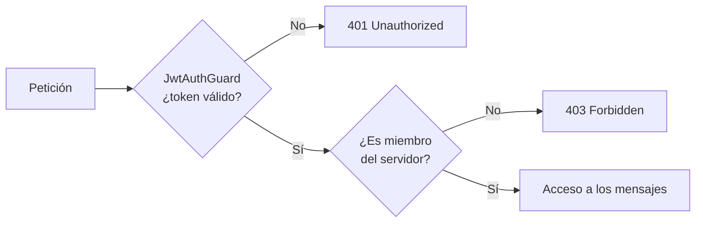
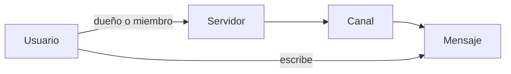

# DiscordClone API

API REST que reproduce el modelo de datos y la lógica básica de Discord: usuarios, servidores, canales y mensajes. Desarrollada con **NestJS y TypeScript**, con **Prisma** sobre **PostgreSQL** y entorno contenerizado con **Docker Compose**.

---

## Funcionalidades

- Registro e inicio de sesión con **JWT** (Passport, `JwtStrategy` y `JwtAuthGuard` para proteger rutas).
- Creación de **servidores**, con un usuario propietario y miembros.
- **Canales** dentro de cada servidor.
- **Mensajes** en los canales, con fecha de creación y de edición.
- **Autorización por pertenencia**: un usuario solo puede leer y escribir mensajes en los servidores de los que es miembro.
- Middleware común para el tratamiento de las peticiones.

---

## Seguridad y autorización




- El `userId` se obtiene siempre del **token JWT**.
- **Escribir un mensaje**: antes de crearlo, se carga el canal con su servidor y se comprueba si el usuario está entre sus miembros. Si no lo está, se devuelve `403 Forbidden`.
- **Leer mensajes**: la consulta de Prisma filtra en la propia base de datos (`members: { some: { id: userId } }`), de modo que solo se devuelven mensajes de los servidores del usuario.

---

## Modelo de datos



Decisiones de diseño:

- **Relación N:N** entre usuarios y servidores para los miembros, separada de la relación de propiedad.
- **Borrado en cascada** de canales y mensajes al eliminar un servidor o un canal.
- Si se elimina un usuario, sus mensajes se conservan con el autor a `null` (`onDelete: SetNull`), como hace Discord.

---

## Estructura

```
src/
├── auth/        Login, registro, estrategia y guard JWT
├── users/       Usuarios
├── servers/     Servidores y miembros
├── channels/    Canales
├── messages/    Mensajes
├── common/      Middleware compartido
└── prisma.service.ts
prisma/
└── schema.prisma
```

Cada dominio es un módulo de NestJS con su *controller*, *service* y DTOs, siguiendo la inyección de dependencias del framework.

---

## Stack

TypeScript · Node.js · NestJS · Prisma ORM · PostgreSQL · JWT (Passport) · Docker · Docker Compose · ESLint · Prettier

---

## Ejecución en local

```bash
# 1. Crear un archivo .env con las variables de entorno
#    (DATABASE_URL y la clave secreta del JWT)

# 2. Levantar los servicios
docker compose up -d

# 3. Aplicar el esquema de base de datos
npx prisma migrate dev

# 4. Arrancar la API en modo desarrollo
npm install
npm run start:dev
```

---
